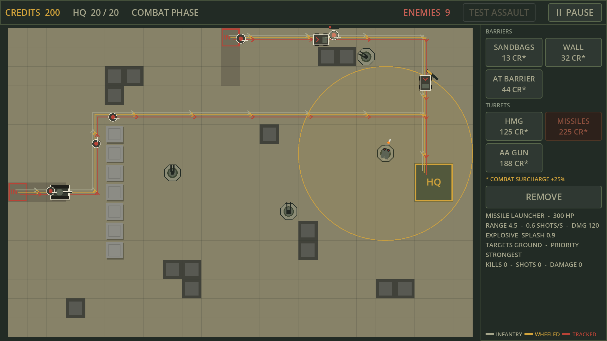

# IRON RAMPART

> **BUILD YOUR DEFENSE. SURVIVE THE ASSAULT.**

Military Maze Tower Defense para Android (2D cenital, horizontal, offline, single-player).
El jugador no defiende rutas fijas: **construye el laberinto** que siguen los enemigos.

**Estado:** Hitos 0–4 completados y verificados en escritorio con Godot 4.7.2. **OPERATION FIRST ASSAULT** es
jugable de principio a fin: preparar la defensa, cinco oleadas, economía de créditos, victoria o derrota con pantalla
de resultados y reinicio. 126/126 pruebas, una partida completa verificada con input simulado y render, simulación de
equilibrio con cinco estrategias. Falta probar en un dispositivo Android. Gráficos y sonido: provisionales.
Detalle en [docs/TESTING.md](docs/TESTING.md).



## Requisitos

| Herramienta | Versión | Para qué |
|---|---|---|
| Godot Engine (estándar, no .NET) | **4.7.2-stable** (mínimo 4.5) | Editor, ejecución, pruebas headless |
| Git | cualquiera reciente | Control de versiones |
| JDK | 17 (recomendado por Godot) | Exportar a Android |
| Android SDK | ver [docs/DECISIONS.md](docs/DECISIONS.md#d-007) | Exportar APK/AAB |
| Export templates de Godot | misma versión exacta que el editor | Exportar |

No hace falta Mac: Android se exporta desde Windows o Linux. Mac solo sería necesario para iOS.

## Instalación

1. Descarga Godot 4.7.2 estándar desde <https://godotengine.org/download/archive/4.7.2-stable/>
   (es un ejecutable portable, no requiere instalador).
2. Clona el repositorio.
3. Primera apertura: abre el editor y usa *Import* sobre `project.godot`, o desde terminal:

```bash
godot --headless --path . --import      # genera .godot/ y registra las clases class_name
```

## Ejecutar

```bash
godot --path .                          # juego (menú principal)
godot --path . res://scenes/gameplay/battle.tscn   # directamente a la misión de prueba
godot -e --path .                       # editor
```

Controles (ratón equivale a toque):

- Selecciona una estructura en el panel derecho.
- Pulsa/arrastra sobre el mapa: la previsualización es **verde** (válida) o **roja** (con el motivo en el panel).
- Suelta para construir. Soltar fuera del mapa cancela.
- `REMOVE`: primer toque selecciona, segundo toque confirma (muestra el reembolso antes).
- Clic derecho / `Esc` / botón Atrás de Android: cancelar herramienta.
- Cámara: pellizco o rueda = zoom; dos dedos, botón central o arrastrar sin herramienta = desplazar.
- `START WAVE N`: lanza la siguiente oleada (no hay límite de tiempo para prepararse). El panel INTEL muestra qué viene.
- `PAUSE`: congela la batalla y conserva el estado.
- Sin herramienta, tocar una torreta muestra su alcance y estadísticas. En combate, construir cuesta +25 % (se
  muestra en el botón y sobre la previsualización).
- Las líneas de colores muestran la ruta actual de cada clase de movimiento
  (arena = infantería, oro = ruedas, rojo = orugas).

## Pruebas

```bash
godot --headless --path . --import
godot --headless --path . --script res://tests/run_tests.gd
```

Código de salida 0 = todo pasa. Detalles en [docs/TESTING.md](docs/TESTING.md).

## Documentación

| Documento | Contenido |
|---|---|
| [CLAUDE.md](CLAUDE.md) | Instrucciones permanentes para sesiones de desarrollo con Claude Code |
| [docs/GAME_DESIGN.md](docs/GAME_DESIGN.md) | Diseño: mecánicas, estructuras, enemigos, economía, formato de niveles |
| [docs/ARCHITECTURE.md](docs/ARCHITECTURE.md) | Sistemas, escenas, datos, señales |
| [docs/DECISIONS.md](docs/DECISIONS.md) | Decisiones técnicas y motivos |
| [docs/ROADMAP.md](docs/ROADMAP.md) | Hitos, criterios de aceptación, tareas pendientes |
| [docs/ART_DIRECTION.md](docs/ART_DIRECTION.md) | Paleta, escalas, pipeline de arte |
| [docs/TESTING.md](docs/TESTING.md) | Estrategia de pruebas y resultados verificados |
